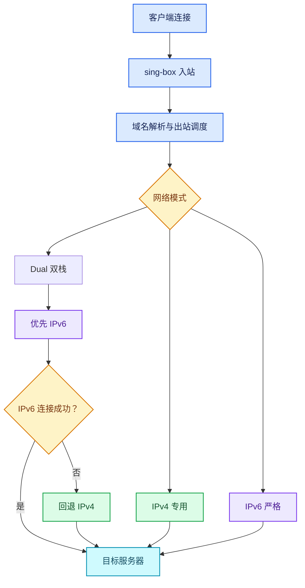
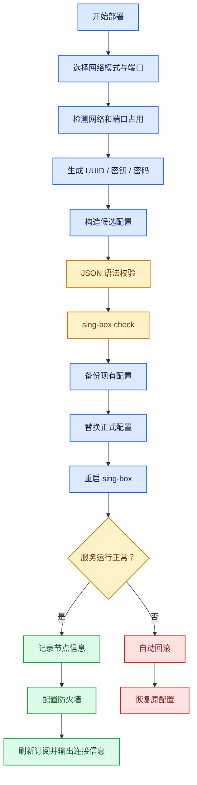

<div align="center">

# sing-box VPS

### Dual-Stack Intelligent Management

**面向 Debian / Ubuntu VPS 的 sing-box 一键部署与智能运维工具**

单文件 Bash · IPv4 / IPv6 双栈 · 多协议部署 · 自动化运维

<p>
  <a href="https://github.com/lisiyong0707/singbox">
    
  </a>
  
  
  
  
  
</p>

[项目介绍](#-项目介绍) · [功能清单](#-功能清单) · [快速安装](#-快速安装) · [命令列表](#-命令行使用) · [常见问题](#-常见问题)

</div>

---

## 🧩 核心功能

<table>
<tr>
<td width="50%" align="center">

### 🌐 双栈智能调度

IPv4 / IPv6 / Dual 三种模式

IPv6 优先，IPv4 回退

IPv4 专用与 IPv6 严格模式

</td>
<td width="50%" align="center">

### 🛡️ 多协议部署

VLESS Reality / gRPC

ShadowTLS / Shadowsocks 2022

Trojan / Hysteria2 / TUIC / Snell

</td>
</tr>
<tr>
<td width="50%" align="center">

### ☁️ Cloudflare 集成

Cloudflare Tunnel 穿透

Cloudflare WARP SOCKS5 出站

Token / 本机创建模式

</td>
<td width="50%" align="center">

### ⚙️ 自动化运维

多格式订阅自动生成

配置备份与失败回滚

健康检查 / 日志 / 测速 / 防火墙

</td>
</tr>
</table>

<p align="center"><b>一个脚本，完成 sing-box VPS 的部署、配置与日常管理。</b></p>

---

## 📑 目录

- [🧭 项目介绍](#-项目介绍)
- [✨ 功能清单](#-功能清单)
- [📋 环境要求](#-环境要求)
- [🚀 快速安装](#-快速安装)
- [🌐 网络架构与双栈策略](#-网络架构与双栈策略)
- [🔐 协议选型指南](#-协议选型指南)
- [🖥️ 交互式管理菜单](#️-交互式管理菜单)
- [⌨️ 命令行使用](#️-命令行使用)
- [🛡️ 节点部署与安全机制](#️-节点部署与安全机制)
- [🔥 防火墙管理](#-防火墙管理)
- [📦 订阅系统](#-订阅系统)
- [☁️ Cloudflare Tunnel](#️-cloudflare-tunnel)
- [🌍 Cloudflare WARP](#-cloudflare-warp)
- [📜 证书管理](#-证书管理)
- [🩺 诊断与自动化运维](#-诊断与自动化运维)
- [🗂️ 数据目录结构](#️-数据目录结构)
- [🔄 更新与升级](#-更新与升级)
- [🗑️ 卸载与彻底清除](#-卸载与彻底清除)
- [❓ 常见问题](#-常见问题)
- [⚠️ 免责声明](#️-免责声明)

---

## 🧭 项目介绍

`singbox` 是一款基于 Bash 编写的 sing-box VPS 部署与管理脚本，主要面向 Debian / Ubuntu 系统。

项目采用单文件设计，将节点部署、网络管理、订阅生成、Cloudflare 集成及系统运维整合到一个管理工具中。

支持交互式菜单和命令行两种使用方式。安装完成后，在任意目录输入 `sb` 即可进入管理控制台。

### 🎯 项目特点

| 特性 | 说明 |
|---|---|
| 📄 单文件设计 | 核心功能集中在一个 Bash 脚本中 |
| 🌐 双栈智能调度 | 支持 IPv4、IPv6 和 Dual 双栈模式 |
| 🔌 多协议支持 | 集成多种主流 sing-box 入站协议 |
| ☁️ Cloudflare 集成 | 支持 Tunnel 穿透和 WARP 出站 |
| 📦 自动订阅 | 生成多种客户端兼容的订阅格式 |
| 🛡️ 安全配置 | 候选配置校验、自动备份、失败回滚 |
| 🩺 自动化运维 | 日志、诊断、测速、健康检查和对账 |
| 🧰 统一管理 | 通过 `sb` 命令管理所有功能 |

## ✨ 功能清单

| 功能分类 | 支持内容 |
|---|---|
| 🔐 Reality | VLESS Reality Dual / IPv4 / IPv6、Reality gRPC |
| 🛡️ 抗探测协议 | ShadowTLS v3 + Shadowsocks 2022 |
| 🔌 经典协议 | SS2022、Trojan TLS、VLESS TLS、Hysteria2、TUIC v5、AnyTLS、NaiveProxy |
| 🧩 特殊协议 | Snell v5 / v6 |
| ☁️ 网络穿透 | Cloudflare Tunnel + VLESS WebSocket |
| 🌍 出站管理 | Cloudflare WARP SOCKS5 |
| 📦 订阅管理 | Base64、sing-box JSON、Clash Meta / Mihomo YAML |
| 📜 证书管理 | Certbot 签发、自动续期、已有 PEM 证书 |
| 🔥 防火墙 | UFW、firewalld、iptables、nftables |
| 🩺 系统运维 | 状态、日志、诊断、测速、BBR、健康检查 |
| ♻️ 配置管理 | 自动备份、回滚、reconcile 对账 |
| 🧰 程序管理 | 安装、升级、自更新、卸载、彻底清除 |

---

## 📋 环境要求

| 项目 | 要求 |
|---|---|
| 🐧 操作系统 | Debian / Ubuntu |
| 🧱 系统架构 | sing-box 官方支持的架构 |
| 🔑 运行权限 | root |
| ⚙️ 服务管理 | systemd |
| 📦 软件包管理 | APT |
| 🔧 sing-box | 建议 1.12.0 或更高版本 |
| 🧩 Snell | 需要 sing-box 1.14.0 或更高版本 |
| 🌐 网络环境 | 根据部署协议提供相应的 IPv4 / IPv6 网络能力 |

### ⚠️ 注意事项

1. 脚本需要 root 权限运行。
2. 纯 IPv6 VPS 如果无法直接访问 GitHub，需要配置 DNS64 / NAT64，或手动上传脚本。
3. 部署 UDP 协议时，需要确保 VPS 网络和云厂商安全组允许 UDP 流量。
4. 部署需要域名证书的协议时，需要提前准备域名和 DNS 解析。
5. 云厂商网页安全组不受脚本控制，需要单独配置。

---

## 🚀 快速安装

### ⚡ 方式一：一键安装

```bash
bash <(curl -fsSL https://raw.githubusercontent.com/lisiyong0707/singbox/main/sb.sh)
```

### 📥 方式二：下载后安装（推荐）

下载脚本：

```bash
curl -fsSL https://raw.githubusercontent.com/lisiyong0707/singbox/main/sb.sh -o sb.sh
```

执行安装：

```bash
sudo bash sb.sh install
```

如果当前已经是 root 用户：

```bash
bash sb.sh install
```

### 📂 安装位置

脚本会安装到以下目录：

```text
/usr/local/sbin/sing-box-vps
/usr/local/bin/sb
```

- `/usr/local/sbin/sing-box-vps`：脚本主体。
- `/usr/local/bin/sb`：快捷命令。

安装完成后，在任意目录输入：

```bash
sb
```

即可进入管理菜单。

### 🔎 检查安装状态

```bash
sb status
sb health
sing-box version
```

---

## 🌐 网络架构与双栈策略

脚本支持三种网络模式，适用于不同网络环境的 VPS。

### 🧭 网络模式

| 模式 | 监听地址 | 出站策略 |
|---|---|---|
| 🌐 Dual 双栈 | `::` | 优先 IPv6，失败回退 IPv4 |
| 🔵 IPv4 专用 | `0.0.0.0` | 仅使用 IPv4 |
| 🟣 IPv6 严格 | `::` | 仅使用 IPv6，不回退 |

### 🔄 Dual 双栈工作原理

Dual 模式通过 sing-box 的 `domain_resolver` 配置实现 IPv6 优先的域名解析和出站策略。



### 🧪 网络检测

在部署 IPv4 / IPv6 专用节点前，脚本会先检测对应网络的外网连通性。

如果指定网络不可用，脚本会拒绝部署，避免生成无法正常使用的节点。

### 🧠 DNS 策略

脚本采用 sing-box 的 `domain_resolver` 机制：

| 策略 | 说明 |
|---|---|
| `ipv4_only` | 仅使用 IPv4 解析 |
| `ipv6_only` | 仅使用 IPv6 解析 |
| `prefer_ipv6` | 优先使用 IPv6 |

不使用已经废弃的 `domain_strategy` 配置方式，以适配 sing-box 1.12 及之后的版本。

> ⚠️ **注意：** IPv6 优先与 IPv4 回退受 DNS 解析、连接策略和目标网络可达性影响，不代表所有类型的连接故障都能无条件自动切换。

---

## 🔐 协议选型指南

不同协议适用于不同的网络环境和使用场景。

### 🧩 协议选择参考

| 使用场景 | 推荐协议 | 说明 |
|---|---|---|
| ⭐ 通用首选 | VLESS Reality Vision | 无需自有证书 |
| 🔗 需要 gRPC | VLESS Reality gRPC | 支持 gRPC 传输 |
| 🛡️ 对主动探测敏感 | ShadowTLS v3 + SS2022 | 组合式协议方案 |
| 🚀 跨洋、高丢包线路 | Hysteria2 / TUIC v5 | 基于 UDP |
| 📜 已有域名与证书 | Trojan / VLESS TLS / AnyTLS | 标准 TLS 接入 |
| 🌍 需要 HTTP 代理 | NaiveProxy | 基于 HTTPS 代理机制 |
| ☁️ IP 被封或没有公网端口 | Cloudflare Tunnel | 通过 Cloudflare 接入 |
| 📱 Surge 用户 | Snell | 支持 Snell v5 / v6 |

### 📜 证书需求

| 协议 | 是否需要自己的域名证书 |
|---|---|
| VLESS Reality | ❌ 否 |
| Reality gRPC | ❌ 否 |
| ShadowTLS | ❌ 否 |
| Shadowsocks 2022 | ❌ 否 |
| Trojan TLS | ✅ 是 |
| VLESS TLS | ✅ 是 |
| Hysteria2 | ✅ 是 |
| TUIC | ✅ 是 |
| AnyTLS | ✅ 是 |
| NaiveProxy | ✅ 是 |
| Snell | ❌ 不需要自有 TLS 证书 |

Reality 和 ShadowTLS 需要选择握手伪装域名，但不需要为自己的 VPS 申请证书。

---

## 🖥️ 交互式管理菜单

安装完成后执行：

```bash
sb
```

进入主菜单。

```text
 1) VLESS Reality Dual        2) VLESS Reality IPv4       3) VLESS Reality IPv6
 4) Reality gRPC              5) ShadowTLS + SS2022       6) Cloudflare Tunnel 管理
 7) Shadowsocks 2022          8) Trojan + TLS             9) VLESS + TLS
10) Hysteria2                11) TUIC v5                 12) AnyTLS
13) NaiveProxy               14) Snell
15) 订阅系统管理             16) Cloudflare WARP         17) 服务器测速
18) 节点管理                 19) 诊断与运维              20) 系统维护
 0) 退出
```

终端宽度不小于 100 列时使用紧凑布局，否则自动切换为单列显示。

---

## ⌨️ 命令行使用

除了交互菜单，脚本也支持直接通过命令执行操作。

**基本格式：**

```bash
sb [命令]
```

### 🚀 1. 节点部署

| 命令 | 功能 |
|---|---|
| `sb install` | 📦 安装 / 修复 sing-box 环境 |
| `sb reality-dual` | 🌐 部署 Reality 双栈节点 |
| `sb reality-v4` | 🔵 部署 Reality IPv4 节点 |
| `sb reality-v6` | 🟣 部署 Reality IPv6 节点 |
| `sb reality-grpc` | 🔗 部署 Reality gRPC |
| `sb shadowtls` | 🛡️ 部署 ShadowTLS v3 + SS2022 |
| `sb ss` | 🔐 部署 Shadowsocks 2022 |
| `sb trojan` | 📜 部署 Trojan TLS |
| `sb vless` | 🔒 部署 VLESS TLS |
| `sb hy2` | 🚀 部署 Hysteria2 |
| `sb tuic` | ⚡ 部署 TUIC v5 |
| `sb anytls` | 🔗 部署 AnyTLS |
| `sb naive` | 🌍 部署 NaiveProxy |
| `sb snell` | 📱 部署 Snell v5 / v6 |

### 🧰 2. 节点管理

| 命令 | 功能 |
|---|---|
| `sb menu` | 🖥️ 打开交互菜单 |
| `sb links` | 🔗 查看全部客户端连接串 |
| `sb qrcode` | 📱 显示指定节点二维码 |
| `sb edit` | ✏️ 编辑节点参数 |
| `sb remove` | 🗑️ 删除指定入站节点 |
| `sb sub` | 📦 订阅系统管理 |
| `sb cftunnel` | ☁️ Cloudflare Tunnel 管理 |
| `sb warp` | 🌍 Cloudflare WARP 管理 |
| `sb certs` | 📜 证书管理 |

`sb edit` 支持修改节点名称、端口、连接地址、握手域名及 TLS 域名。

删除节点时，会联动清理相关 detour、路由规则和防火墙放行规则。

### 🩺 3. 系统运维

| 命令 | 功能 |
|---|---|
| `sb status` | 📊 查看服务、网络、公网 IP 和监听端口 |
| `sb logs` | 📋 查看最近 150 行 sing-box 日志 |
| `sb check` | ✅ 校验配置并重启服务 |
| `sb health` | ❤️ 执行健康检查 |
| `sb diag` | 🩺 系统综合诊断 |
| `sb speedtest` | 🚀 网络延迟和速度测试 |
| `sb bbr` | ⚡ 启用 BBR 拥塞控制 |
| `sb reconcile` | 🔄 配置与防火墙对账 |
| `sb rollback` | ↩️ 回滚到最近一次配置备份 |
| `sb upgrade` | ⬆️ 升级 sing-box 核心 |
| `sb cf-upgrade` | ☁️ 升级 cloudflared |
| `sb self-update` | 🔄 从 GitHub 更新管理脚本 |
| `sb uninstall` | 📤 卸载 sing-box，保留数据 |
| `sb purge` | 🗑️ 彻底清除相关组件和数据 |

---

## 🛡️ 节点部署与安全机制

脚本在部署节点时采用候选配置机制，避免错误配置直接覆盖正在使用的正式配置。

### 🔄 部署流程



### 🔒 安全保障

**1. ✅ 配置校验**

每次部署都会先生成临时配置，并依次执行：

- JSON 语法检查。
- `sing-box check` 配置检查。
- 服务重启验证。

只有校验通过后，才会替换正式配置。

**2. ♻️ 自动备份与回滚**

- 每次修改配置前自动备份。
- 默认保留最近 15 份配置备份。
- 服务重启失败时自动回滚。
- 支持通过 `sb rollback` 手动恢复。

**3. 🔐 并发保护**

使用 `flock` 文件锁，避免多个 `sb` 实例同时修改配置。

**4. 🧪 输入安全**

- 对端口、域名、IP 地址进行格式校验。
- 对用户输入进行安全字符限制。
- 不使用 `eval` 执行动态命令。

**5. 🚨 异常处理**

采用：

```bash
set -Eeuo pipefail
```

统一错误陷阱会输出出错函数、行号和调用链。

如果部署过程中通过 Ctrl+C 等方式中断，建议执行：

```bash
sb reconcile
```

检查配置记录和防火墙状态。

**6. 📋 日志管理**

脚本运行日志保存在：

```text
/var/lib/sing-box-vps/sing-box-vps.log
```

通过 logrotate 进行日志轮转。

---

## 🔥 防火墙管理

脚本支持自动检测并使用可用的防火墙后端。

### 🧱 后端探测顺序

1. UFW
2. firewalld
3. iptables / ip6tables
4. nftables

nftables 使用脚本专用表：

```text
sing_box_vps
```

### ⚙️ 自动管理功能

- 部署节点时自动放行对应端口。
- 修改端口时撤销旧端口规则并添加新规则。
- 删除节点时清理对应防火墙规则。
- IPv4 和 IPv6 防火墙规则分别处理。
- `sb reconcile` 检查防火墙规则是否存在缺口。

### ⚠️ 注意事项

云厂商控制台中的网页安全组不受本脚本控制，需要自行配置。

| 协议 | 端口类型 |
|---|---|
| Reality | TCP |
| ShadowTLS | TCP |
| Shadowsocks 2022 | 根据实际配置放行 TCP / UDP |
| Trojan | TCP |
| VLESS TLS | TCP |
| Hysteria2 | UDP |
| TUIC | UDP |
| AnyTLS | TCP |
| NaiveProxy | TCP |
| Snell | 按实际部署配置 |

如果使用 IPv6，还需要单独检查云平台 IPv6 安全组规则。

---

## 📦 订阅系统

脚本支持自动生成多种客户端订阅格式。

订阅文件默认保存在：

```text
/var/lib/sing-box-vps/subscriptions/
```

### 📄 订阅格式

| 文件 | 格式 | 适用客户端 |
|---|---|---|
| `sub-universal.txt` | Base64 URI 列表 | Shadowrocket、v2rayN、NekoBox 等 |
| `sub-singbox.json` | sing-box Outbounds JSON | sing-box 客户端 |
| `sub-clash.yaml` | Clash Meta / Mihomo YAML | Clash Meta、Mihomo |

### 🔄 自动更新机制

每次部署节点后，脚本会自动刷新订阅文件。

也可以手动执行：

```bash
sb sub
```

进入订阅管理菜单。

> ⚠️ **格式说明：**
> - ShadowTLS 节点目前只写入通用订阅。
> - ShadowTLS 不会写入 sing-box JSON 和 Clash YAML。
> - sing-box JSON 仅包含 `outbounds` 片段，需要自行合并进客户端完整配置。

### 🌐 本地订阅 HTTP 服务

脚本支持启动本地 Python HTTP 服务。

默认监听：

```text
127.0.0.1:28080
```

服务采用 Token 验证机制，避免未经授权的访问。

#### 🔗 支持的订阅地址

| 路径 | 返回格式 |
|---|---|
| `/sub?token=xxx` | 根据 User-Agent 自动识别格式 |
| `/sub-clash.yaml?token=xxx` | Clash / Mihomo |
| `/sub-singbox.json?token=xxx` | sing-box |
| `/sub-universal.txt?token=xxx` | 通用 Base64 |

#### 🔐 访问安全

- 默认仅监听本机 `127.0.0.1`。
- 每个订阅请求都需要提供 Token。
- 支持查看和重置 Token。
- 重置后旧订阅链接立即失效。

如果需要从公网访问，可以使用 Nginx / Caddy 反向代理，并配置 HTTPS。

> ⚠️ 建议不要直接将本地订阅服务暴露到公网。

---

## ☁️ Cloudflare Tunnel

脚本通过 `sb cftunnel` 管理 Cloudflare Tunnel。

### 🧰 支持功能

- 新建 Tunnel。
- 部署 VLESS + WebSocket 节点。
- 查看 Tunnel 状态。
- 查看运行日志。
- 重启 / 停止服务。
- 重新绑定 Token。
- 卸载 Tunnel。
- 升级 cloudflared。

### 🔑 两种接入方式

**方式一：Token 模式（推荐）**

在 Cloudflare Zero Trust 后台创建 Tunnel，复制 Token 并粘贴到脚本中。

随后在 Cloudflare 后台添加 Public Hostname：

| 配置项 | 示例 |
|---|---|
| Subdomain | `cf` |
| Domain | `example.com` |
| Type | HTTP |
| URL | `127.0.0.1:本地端口` |

脚本会在本地部署 VLESS WS 服务。

**方式二：本机新建模式**

通过 cloudflared 官方命令完成授权和创建：

```bash
cloudflared tunnel login
cloudflared tunnel create my-tunnel
```

脚本负责生成：

```text
/etc/cloudflared/config.yml
```

并创建对应的 systemd 服务。

### 🔄 连接架构


### ⚠️ 注意事项

- 本地 VLESS WS 服务默认只监听 `127.0.0.1`。
- 客户端通过 Cloudflare 域名和 HTTPS / WebSocket 接入。
- Tunnel Token 属于敏感凭证，不要公开。
- Tunnel 依赖 cloudflared 与 Cloudflare 网络正常连接。

部署完成后，脚本会执行连通性自检并给出结果提示。

---

## 🌍 Cloudflare WARP

脚本通过 Cloudflare 官方 `cloudflare-warp` 客户端部署 WARP。

执行：

```bash
sb warp
```

进入管理菜单。

### ⚙️ 工作方式

使用 WARP proxy 模式运行，不修改宿主机全局路由。

默认 SOCKS5 监听地址：

```text
127.0.0.1:40000
```

脚本会在 sing-box 中添加名为：

```text
warp-out
```

的 SOCKS 出站。

### ⚠️ 注意事项

1. 只添加 WARP 出站，不会自动修改现有节点的流量路由。
2. 如果需要使用 WARP，需要自行编辑路由规则，将指定流量的出站目标设置为 `warp-out`。
3. 官方 warp-cli 不支持强制锁定 IPv4 / IPv6 出口，因此脚本不提供该选项。
4. WARP 服务状态与 sing-box 服务状态相互独立。

---

## 📜 证书管理

通过以下命令进入证书管理：

```bash
sb certs
```

### 🧰 支持功能

- 查看配置中本地证书的到期时间。
- 立即续期。
- 重新申请证书。
- 启用自动续期。
- 检查自动续期状态。
- 使用已有 PEM 证书。

### 🔏 证书签发方式

使用 Certbot standalone 模式申请证书。

申请前需要满足：

1. 域名已经解析到 VPS。
2. A / AAAA 记录配置正确。
3. VPS 的 80 端口可以正常访问。
4. 80 端口没有被 Nginx / Caddy 等其他服务占用。

脚本会检查端口占用并放行 80 端口。

### 🔄 自动续期

优先使用：

```text
certbot.timer
```

如果不可用，则通过 cron 实现自动续期。

证书续期后，通过 deploy hook 自动重启 sing-box。

---

## 🩺 诊断与自动化运维

脚本集成多项运维工具，方便排查 VPS 网络和节点故障。

### 🔎 系统诊断

执行：

```bash
sb diag
```

检查项目包括：

| 检查项目 | 说明 |
|---|---|
| 💽 磁盘 | 磁盘空间使用情况 |
| 🧮 Inode | Inode 使用情况 |
| 🧠 内存 | 内存使用情况 |
| 📈 系统负载 | CPU / 系统负载 |
| 🔌 端口 | 服务监听和端口占用 |
| 🌐 DNS | DNS 解析状态 |
| 🔵 IPv4 | IPv4 外网连通性 |
| 🟣 IPv6 | IPv6 外网连通性 |
| ⚡ BBR | TCP 拥塞控制状态 |
| 🔥 防火墙 | 防火墙规则与端口放行 |
| ☁️ Cloudflare | Tunnel 运行状态 |
| ⚙️ sing-box | 配置和服务状态 |

### ❤️ 健康检查

执行：

```bash
sb health
```

主要检查：

- JSON 语法。
- sing-box 服务状态。
- cloudflared 服务状态。
- WARP 服务状态。
- sing-box 出站列表。

### 🚀 网络测速

执行：

```bash
sb speedtest
```

支持：

- Cloudflare 延迟测试。
- Cloudflare 下载速度测试。
- Cloudflare 上传速度测试。
- Google 延迟测试。
- Microsoft 延迟测试。

其中 Google / Microsoft 仅进行延迟测试。

### 🔄 配置对账

执行：

```bash
sb reconcile
```

**1. 节点配置对账**

比较：

```text
/etc/sing-box/config.json
/var/lib/sing-box-vps/connections.json
```

检查入站配置与节点记录是否一致。

发现孤儿项后，会逐项询问是否处理。

**2. 防火墙对账**

检查每个监听端口是否在本机防火墙中正确放行。

如果发现规则缺失，会逐项询问是否补充。

> ℹ️ `reconcile` 默认以检查和报告为主，不会静默清理配置或修改防火墙。

### ⚡ BBR

执行：

```bash
sb bbr
```

启用 BBR TCP 拥塞控制。

实际效果取决于内核版本、系统支持情况和网络环境。

---

## 🗂️ 数据目录结构

脚本采用统一目录管理配置、数据、日志、备份和订阅文件。

```text
/etc/sing-box/
└── config.json                  # sing-box 主配置

/var/lib/sing-box-vps/
├── connections.json             # 节点连接记录
├── cf_tunnel.json               # Cloudflare Tunnel 记录
├── sub_token                    # 订阅访问 Token
├── sub-server.py                # 本地订阅服务
├── ip_cache                     # 公网 IP 缓存
├── sing-box-vps.log             # 脚本运行日志
├── backups/                     # 配置备份，最多 15 份
├── subscriptions/               # 订阅文件
└── qrcache/                     # 节点二维码 PNG

/etc/cloudflared/
├── config.yml                   # 本机新建模式的 Tunnel 配置
└── creds/                       # Tunnel 凭证

/usr/local/sbin/
└── sing-box-vps                 # 脚本主体

/usr/local/bin/
└── sb                           # 快捷命令
```

### 🔐 敏感文件保护

以下文件包含节点密钥或访问凭证：

```text
/var/lib/sing-box-vps/connections.json
/var/lib/sing-box-vps/sub_token
/etc/sing-box/config.json
/etc/cloudflared/creds/
```

相关敏感文件应限制访问权限。

脚本对节点记录和 Token 文件使用 `600` 权限。

> 🚨 请勿将包含节点密码、UUID、Private Key 或 Tunnel Token 的文件上传到公开仓库。

---

## 🔄 更新与升级

脚本提供三种独立更新方式。

### 📦 更新 sing-box 核心

执行：

```bash
sb upgrade
```

用于升级 sing-box 软件包。

### 🧰 更新管理脚本

执行：

```bash
sb self-update
```

从 GitHub 获取最新脚本并更新本地安装版本。

项目地址：

https://github.com/lisiyong0707/singbox

### ☁️ 更新 cloudflared

执行：

```bash
sb cf-upgrade
```

升级 Cloudflare Tunnel 客户端。

### ⚠️ 更新注意事项

- 更新前建议备份配置。
- 升级后建议执行 `sb health`。
- 如果更新过程中出现异常，可使用 `sb rollback` 恢复最近一次配置备份。
- 第三方 APT 源错误可能导致相关软件包更新失败，需要单独检查源和密钥。

---

## 🗑️ 卸载与彻底清除

脚本提供两种卸载方式。

### 📤 方式一：普通卸载

执行：

```bash
sb uninstall
```

仅卸载 sing-box 软件包，保留配置和数据。

适用于：

- 重新安装 sing-box。
- 暂时停用 sing-box。
- 保留现有节点配置。

### 🧹 方式二：彻底清除

执行：

```bash
sb purge
```

彻底清除相关组件和数据。

可能清理的内容包括：

- sing-box 软件包。
- cloudflared。
- Cloudflare WARP。
- sing-box 配置。
- 节点连接记录。
- 订阅文件及 Token。
- systemd 服务单元。
- APT 软件源。
- logrotate 配置。
- 证书续期钩子。
- 可选的 Certbot 证书。
- 可选的本机防火墙规则。

执行前必须输入大写：

```text
DELETE
```

确认操作。

> 🚨 **警告：`purge` 是不可逆操作。** 此操作不创建备份，执行前请确认不再需要现有配置和数据。云厂商安全组需要自行清理。

---

## ❓ 常见问题

### 1. 🔌 节点部署成功，但客户端无法连接？

建议按以下顺序排查：

```bash
sb status
sb diag
sb health
sb reconcile
```

重点检查：

- 云厂商安全组是否放行端口。
- IPv4 / IPv6 规则是否分别配置。
- UDP 协议是否放行 UDP 端口。
- sing-box 是否正常运行。
- 节点监听地址是否正确。
- 客户端连接参数是否一致。

部分网络会限制 UDP，可以尝试使用 Reality 等 TCP 协议。

### 2. 📜 证书申请失败？

检查：

- 域名 A / AAAA 记录是否正确。
- 域名是否解析到当前 VPS。
- 80 端口是否被其他服务占用。
- 云厂商安全组是否放行 TCP 80。

也可以选择使用已有 PEM 证书。

### 3. ⬆️ 提示 sing-box 版本过低？

执行：

```bash
sb upgrade
```

Snell 需要 sing-box 1.14.0 或更高版本。

### 4. ♻️ 配置文件被修改或损坏？

执行：

```bash
sb rollback
```

恢复最近一次配置备份。

恢复后建议执行：

```bash
sb check
sb health
```

### 5. 📦 更新脚本时出现 APT 源错误？

某些第三方软件源可能因密钥失效、源地址变化或系统版本不兼容而报错。

例如旧的 cloudflared 软件源。

需要单独检查对应的软件源。第三方源异常不代表 sing-box 官方软件源一定不可用。

### 6. 🌐 IPv6 VPS 无法下载 GitHub 文件？

纯 IPv6 网络可能无法直接访问部分 IPv4-only 服务。

可以选择：

- 配置 DNS64 / NAT64。
- 使用支持 IPv6 的下载镜像。
- 在本地下载 `sb.sh` 后上传到 VPS。

---

## ⚠️ 免责声明

本项目仅用于 Linux 系统网络管理、服务器运维和技术交流。

使用者应遵守所在地法律法规、云服务提供商使用条款及相关网络服务规定。

本项目不对因错误配置、服务器故障、网络中断、第三方服务变化或不当使用造成的损失承担责任。

使用者应自行评估风险，并对服务器配置、访问凭证及数据安全负责。

---

<div align="center">

## ⭐ 项目地址

<a href="https://github.com/lisiyong0707/singbox">
  
</a>

**sing-box VPS · Dual-Stack Intelligent Management**

<sub>Simple Deployment · Multi-Protocol · Automated Operations</sub>

</div>
